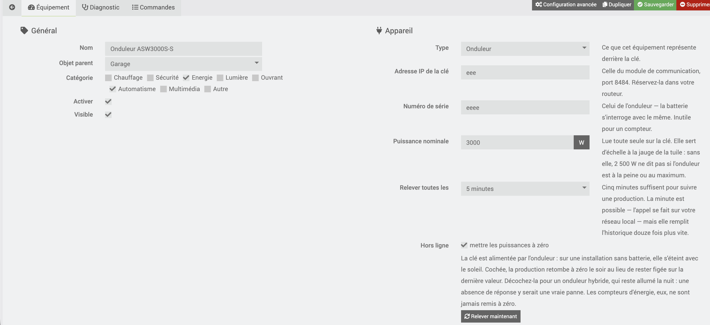
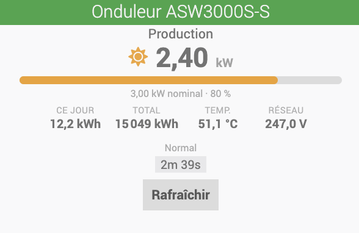

# Solplanet plugin

Reads **Solplanet** photovoltaic inverters fitted with an **AiSWEI**
communication stick (Wi-Fi or Ethernet) over the local network, without going
through the manufacturer's cloud and without creating an account.

The plugin discovers what sits behind the stick's IP address — inverter,
bidirectional meter, battery — and creates one Jeedom device for each. A cron
then polls them at the interval you choose.

## Requirements

- A Solplanet, VoltX or AiSWEI photovoltaic installation whose inverter carries
  its communication stick.
- That stick on the same network as Jeedom. No port forwarding, no inverter-side
  setup: the service listens on port 8484 and answers without authentication.

Reserve the stick's IP address in your router. If it changes, the plugin finds
nothing any more, and nothing will tell you before you look at the charts.

## Installation

1. Install the plugin, then enable it.
2. Open **Plugins → Energy → Solplanet**.
3. Click **Search for devices** and enter the stick's IP address.

The plugin queries the stick and shows what it declares. Confirm, and the devices
are created with their commands; the first reading follows immediately.

Manual creation is still possible: device type, IP address, inverter serial
number. The serial number appears in the Solplanet application, or in the
discovery answer.



### Finding the stick's address

It is the address your router gives to the module plugged into the inverter, not
the router's own. Two ways to recognise it:

- in your router's list of connected devices, an entry whose name often starts
  with `AiSWEI` or `Solplanet`;
- from a shell, the answer to a direct call:

```bash
curl -s --max-time 5 "http://192.168.0.42:8484/getdev.cgi?device=2"
```

A JSON answer containing `isn` confirms the address and gives you the inverter's
serial number.

## What you see on the dashboard

Each device shows **one tile only**. That is a deliberate choice: nineteen
stacked widgets cannot be read, whereas an inverter asks a single question —
"how much is it producing?" — and a tile answers it in full.



The inverter tile shows instant power large, a gauge against rated power
(2.50 kW on a 3 kW inverter is 83 %; the figure alone would not say so), daily
and total energy, temperature, grid voltage and status. As soon as there is more
than one PV string, the detail of each is added: it is the comparison that shows
a string in the shade or at fault, not the isolated value.

The meter and the battery have their own tile: current direction and indexes on
one side, state of charge and power on the other.

**Every other command still exists, but is hidden.** They are historized and
usable in scenarios, charts and views. To show one on the dashboard, tick
"Display" in the device's *Commands* tab.

Three settings are available on the tile itself, through the widget's "Advanced
configuration" button: `gauge`, `facts` and `strings`, set to `0` to hide
respectively the gauge, the secondary figures and the per-string detail.

At night the tile dims and shows "Asleep — the stick is not answering". It keeps
the last known value rather than emptying itself: you see at a glance that the
data is no longer fresh, without losing the information.

## The devices

One Jeedom device stands for **one physical device**. The three families share
the stick's address but have neither the same commands nor the same useful pace.

### Inverter

| Command | Unit | What it is |
|---|---|---|
| Power | W | AC power being fed in, the instant value |
| Daily energy | kWh | Reset every night by the inverter |
| Total energy | kWh | Index since commissioning |
| PV power | W | Sum of the strings, DC side (when several) |
| Grid voltage / current | V / A | One command per phase |
| Power phase 1…3 | W | Three-phase inverters only |
| PV voltage / current / power | V / A / W | One set per string (MPPT) |
| Temperature | °C | Inverter internal temperature |
| Grid frequency | Hz | |
| Power factor | | |
| Apparent / reactive power | VA / VAr | |
| Operating hours | h | |
| Status | | Normal, Wait, Fault, Checking |
| Error code / Error | | The code and its plain-language label |
| Warning code | | |
| Online | | 1 when the stick answered on the last pass |
| Refresh | | Action command, for use in scenarios |

The number of phases and strings is not guessed: it is read from the stick's
first answer, and the matching commands are created then. A single-phase inverter
therefore has no "phase 2".

Per-string power is not given by the stick: it is computed (voltage × current).
It is the figure most often missing from hand-made readings, and the one that
shows a string in the shade or at fault.

### Meter

| Command | Unit | What it is |
|---|---|---|
| Grid power | W | Signed: positive on import, negative on export |
| Imported / exported power | W | The two halves, always positive |
| Daily import / export | kWh | |
| Total import / export | kWh | Index |
| Online | | |

The three powers say the same thing in three shapes: the signed one suits
scenarios (`< 0` means "we are exporting"), the other two suit Jeedom's energy
widgets, which expect separate positive values.

### Battery

State of charge and of health, signed power and its two halves (charge,
discharge), voltage, current, temperature, charged and discharged energy, daily
and total PV production, backup-supply (EPS) figures, status and error label.

## Polling pace

Each device has its own interval, from one minute to half an hour, **five
minutes by default**. The plugin's cron runs every minute and only polls the
devices whose interval has elapsed.

The call stays on your local network: polling every minute costs almost nothing
in time, but fills the history twelve times faster than every five minutes. To
follow a production, five minutes are plenty.

## Night, and faults

The communication stick is powered by the inverter. On an installation without a
battery, **it goes off with the sun**: the connection is refused all night. This
is not a fault, and the plugin does not treat it as one.

- The **Online** command drops to 0.
- If the **"set powers to zero"** option is ticked — it is by default — powers
  and currents fall back to 0 instead of staying frozen on the evening's last
  value. The production curve comes down as it should.
- **Energy indexes are never touched.** Writing 0 into "Total energy" would dig a
  hole in the history and fire every scenario built on it.
- The log stays quiet: after three consecutive failures the plugin spaces out its
  attempts (from five minutes to one hour) and writes a single `info` line.

Untick the option for a **hybrid inverter**, which stays on at night: there, no
answer would be a real fault, and freezing the last value says more than a
misleading zero.

The device communication timeout (*Advanced configuration* tab) is left at zero,
hence disabled: otherwise Jeedom would raise an alert every evening for normal
behaviour. Enable it if your installation is meant to answer around the clock.

## Diagnostics

Each device's **Diagnostics** tab shows the date of the last successful reading,
the detected shape (phases, strings) and **the raw JSON exactly as the stick
returned it**, before any scaling.

That is the evidence to attach when a value looks wrong: it immediately tells
whether the problem comes from the inverter or from the plugin. Values there are
fixed-scale integers — `2301` for 230.1 V, `345` for 34.5 °C, `123456` for
12,345.6 kWh.

The plugin log is available under **Analysis → Logs → solplanetbe**.

## Frequently asked questions

**Nothing comes back, discovery finds nothing.**
Check the address from the Jeedom machine, not from your desktop:
`curl -s --max-time 5 "http://<ip>:8484/getdev.cgi?device=2"`. If Jeedom runs in
a container or on another VLAN, that is where to look.

**Values are ten times too large.**
Not in this plugin — that is exactly what it fixes. If you see 2301 V, an old
global variable or a virtual device is still lying around in your configuration.

**Can I control the battery?**
Not in this version. The plugin only reads. Writing (work mode, charge
thresholds) exists in the protocol and may come later.

**Several inverters?**
Yes: discovery creates them all, each with its own serial number.

## Credits

Scaling factors and error code tables were taken from the Home Assistant
integration `zbigniewmotyka/home-assistant-solplanet`, published under the MIT
licence.

This plugin is not affiliated with Solplanet or AiSWEI, and is neither sponsored
nor endorsed by them.
